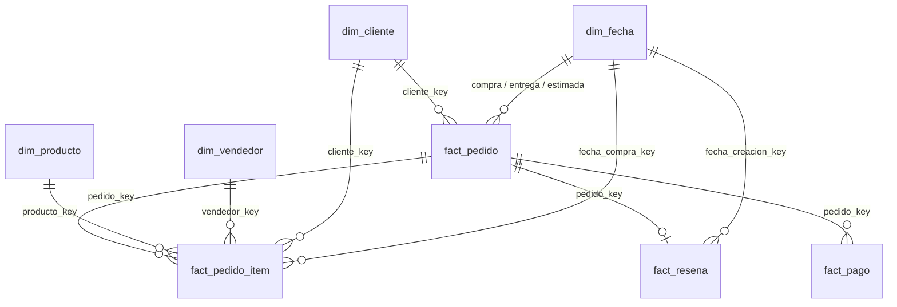

# 02_sql_server – OlistDW y carga de staging

Base **OlistDW** en la instancia SQL Server 2022 Developer **instalada en Windows** (servicio `MSSQLSERVER`, host `GGIOLITTI`), con autenticación de Windows. Esquemas: `stg` (copia fiel de los CSV), `dw` y `ml` (todavía vacíos). Esta carpeta no toca la base `DW_GG` de otros proyectos.

**Por qué el Python de Windows y no el de WSL:** la autenticación de Windows (`Trusted_Connection=yes`) no funciona desde Linux/WSL, y la instancia no escucha en el puerto 1433 (solo en memoria compartida y en `127.0.0.1:1434`). La carga corre en Windows (`py`); el ETL y los modelos siguen en WSL.

## Contenido

| Archivo | Para qué |
|---|---|
| `00_create_database.sql` | Crea `OlistDW` (recovery SIMPLE) y los esquemas `stg`, `dw`, `ml`. Idempotente. |
| `00_limitar_memoria.sql` | Limita `max server memory` de la instancia a 1536 MB (ver abajo). |
| `99_restaurar_memoria.sql` | Vuelve la memoria al valor original. |
| `01_staging/01_crear_tablas_stg.sql` | DDL de las 9 tablas `stg.*` con tipos explícitos. Crea solo si no existen. |
| `cargar_stg.py` | Carga idempotente (vaciar y recargar, una sola transacción) desde los CSV del ETL. Solo `pyodbc` + librería estándar. |
| `ejecutar_sql.py` | Ejecuta uno o varios `.sql` por lotes (`GO`) con el Python de Windows; `--solo-sintaxis` verifica sin ejecutar. |
| `02_dimensional/` | Modelo dimensional `dw`: `01_crear_tablas_dw.sql` (DROP + CREATE), `02_cargar_dimensiones.sql`, `03_cargar_hechos.sql` y `04_crear_map_categoria_es.sql` (traducción de categorías al español, solo para el tablero). |
| `03_views/` | `ml.vw_pedidos_entrenamiento` y las vistas para Power BI (`dw.vw_pedidos`, `vw_vendedores`, `vw_tiempo`, `vw_geografia`). |
| `04_ml/01_crear_tablas_ml.sql` + `cargar_ml.py` | Tablas `ml.*` y su carga desde `04_python_ml/outputs/*.csv`. |
| `validar_dw.py` | Validación de solo lectura (78 comprobaciones); `validacion_dw.md` guarda el último resultado. |
| `diccionario_dw.md` | Diccionario de tablas, columnas, grano y claves del modelo. |

## Límite de memoria de la instancia

La PC tiene 7,7 GB; WSL usa hasta 3,7 GB y Windows tenía ~0,8 GB libres. La instancia estaba **sin límite**, así que durante una carga grande podía quitarle memoria a Windows y a WSL.

| Opción | Valor original (registrado el 2026-11-04) | Valor aplicado |
|---|---|---|
| `max server memory (MB)` | **2147483647** (sin límite) | **1536** |
| `show advanced options` | **0** | 0 (se vuelve a dejar en 0) |

Es una configuración de **toda la instancia** (también afecta a `DW_GG`); no requiere reiniciar el servicio y no toca Analysis Services.

Cuatro scripts (PowerShell, sin reiniciar el servicio):

| Script | Qué hace |
|---|---|
| `00_limitar_memoria.sql` | pone `max server memory` en **1536 MB** (el valor de trabajo). |
| `01_subir_memoria_temporal.sql` | sube a **2304 MB** solo para una tarea pesada y **solo si Windows tiene más de 2 GB de RAM libre** (con menos, SQL Server no puede usar el aumento). |
| `99_restaurar_memoria.sql` | **vuelve a 1536 MB** (después de una subida temporal). |
| `98_quitar_limite_memoria.sql` | quita el límite: vuelve al valor **original** de la instancia (2147483647, sin límite). |

```powershell
sqlcmd -S localhost -E -b -i 02_sql_server\99_restaurar_memoria.sql        # volver a 1536 MB
sqlcmd -S localhost -E -b -i 02_sql_server\98_quitar_limite_memoria.sql    # volver al valor original (sin límite)
```

## Conexión

La cadena va en la variable de entorno de Windows `MSSQL_CONNECTION` (nunca en el código). No lleva contraseña (autenticación de Windows):

```
DRIVER={ODBC Driver 17 for SQL Server};SERVER=localhost;DATABASE=OlistDW;Trusted_Connection=yes;
```

Definirla una vez (PowerShell; queda para el usuario de Windows, se aplica a procesos nuevos):

```powershell
[Environment]::SetEnvironmentVariable('MSSQL_CONNECTION', 'DRIVER={ODBC Driver 17 for SQL Server};SERVER=localhost;DATABASE=OlistDW;Trusted_Connection=yes;', 'User')
```

Alternativa: un archivo `02_sql_server/.env` (ignorado por git) con la línea `MSSQL_CONNECTION=...`. Si `SERVER=localhost` no conectara, probar `SERVER=localhost,1434`. Para quitar la variable: `[Environment]::SetEnvironmentVariable('MSSQL_CONNECTION', $null, 'User')`.

## Orden de ejecución

Todo se ejecuta **de a una cosa por vez: primero la carga, después los modelos** (la RAM no alcanza para las dos a la vez).

```bash
# 1) En WSL, desde proyecto_olist/: exporta las 9 tablas de staging (limpias, en español) a 01_python_etl/data/processed/stg/
.venv/bin/python 01_python_etl/run_etl.py --solo-stg
```

```powershell
# 2) En PowerShell de Windows, desde proyecto_olist\ (por ejemplo: cd \\wsl.localhost\Ubuntu\home\gonza\...\proyecto_olist)
sqlcmd -S localhost -E -b -i 02_sql_server\00_limitar_memoria.sql     # una sola vez
sqlcmd -S localhost -E -b -i 02_sql_server\00_create_database.sql     # una sola vez (idempotente)
py 02_sql_server\cargar_stg.py --probar-conexion
py 02_sql_server\cargar_stg.py --verificar        # compara CSV y manifiesto; no escribe
py 02_sql_server\cargar_stg.py --prueba           # muestra pequeña con ROLLBACK
py 02_sql_server\cargar_stg.py                    # carga completa (se puede repetir: no duplica)
```

`cargar_stg.py` verifica al final que los conteos de cada tabla coincidan con `_manifiesto.csv` y que `id_pedido` sea único en `stg.pedidos`; si algo falla hace ROLLBACK. Si cambia el DDL, usar `--recrear`.

## Resultados de la carga (2026-11-04)

Dos cargas completas seguidas (vaciar y recargar, una transacción cada una), con el Python de Windows 3.13 + pyodbc 5.3.0 contra `OlistDW`. Los modelos no estaban corriendo.

| Tabla `stg.` | Filas (SQL = CSV = manifiesto) | Carga 1 | Carga 2 |
|---|---:|---:|---:|
| pedidos | 99.441 | 7,2 s | 7,1 s |
| clientes | 99.441 | 5,5 s | 5,7 s |
| items_pedido | 112.650 | 7,0 s | 6,8 s |
| pagos | 103.886 | 5,2 s | 5,9 s |
| resenas | 99.224 | 6,1 s | 7,0 s |
| productos | 32.951 | 1,9 s | 1,9 s |
| vendedores | 3.095 | 0,2 s | 0,2 s |
| geolocalizacion (1.000.163 → agregada por prefijo postal) | 19.015 | 0,9 s | 1,0 s |
| traduccion_categorias | 71 | 0,0 s | 0,1 s |
| **Tiempo total, con todas las comprobaciones** | | **99 s** | **56 s** |

- Una carga tarda unos 34 s en insertar y el resto en comparar el contenido con los CSV.
- **Idempotencia:** la carga 2 dio exactamente los mismos conteos, sumas, fechas, claves, nulos y textos que la 1 (se comparó el log completo de ambas, salvo los tiempos). `id_pedido` quedó único en `stg.pedidos` (0 repetidos) y no hay filas duplicadas.
- **Primer intento fallido (queda como antecedente):** la primera carga falló por `right truncation` (el buffer de `fast_executemany` se dimensionaba con la primera fila del bloque); se corrigió fijando el tamaño de cada parámetro según el tipo de la columna (`tamano_parametro()`; 52 columnas mapeadas: nvarchar 25, smallint 8, datetime2 8, decimal 5, int 5, tinyint 1; un tipo no mapeado corta la carga). El segundo intento hizo ROLLBACK por una métrica mía mal planteada (ver nota de UTF-16). En ambos casos las tablas quedaron en 0 filas.

### Comparación de contenido CSV ↔ SQL (141 comprobaciones, 0 diferencias)

Se hace dentro de la misma transacción, antes del COMMIT: si algo difiere, la carga se deshace. Tolerancia: el último decimal declarado en la columna (0 en enteros); la diferencia real fue 0.

| Comprobación | Resultado |
|---|---|
| Conteos de las 9 tablas contra `_manifiesto.csv` | iguales |
| Nulos de las 52 columnas | iguales (p. ej. `fecha_entrega_cliente` 2.965; `titulo_comentario` 87.656; `mensaje_comentario` 58.247; `productos.categoria` 610) |
| Suma de cada columna numérica y diferencia absoluta máxima por valor (valores ordenados, independiente del orden de filas) | diferencia 0 en las 19 columnas |
| Mínimo y máximo de las 8 columnas de fecha | iguales |
| Valores distintos de claves (`id_pedido`, `id_cliente`, `id_producto`, `id_vendedor`) | iguales (p. ej. `pedidos.id_pedido` 99.441; `items_pedido.id_pedido` 98.666; `items_pedido.id_producto` 32.951; `items_pedido.id_vendedor` 3.095) |
| Longitud total de las 25 columnas de texto | iguales |
| Texto de `stg.resenas` (id, título y mensaje) fila por fila | idéntico, carácter por carácter (99.224 filas) |

Sumas de control principales: `items_pedido.precio` 13.591.643,70 · `items_pedido.flete` 2.251.909,54 · `pagos.monto_pago` 16.008.872,12 · `pagos.cuotas` 296.423 · `productos.peso_g` 75.007.492 · `resenas.puntaje` 405.471 · `geolocalizacion.latitud` −362.335,585349 · `geolocalizacion.longitud` −875.786,110816.

**Nota sobre UTF-16 y emojis:** SQL Server guarda `nvarchar` en UTF-16, donde un emoji ocupa 2 unidades (`DATALENGTH/2`), mientras que Python cuenta 1 por carácter. Las reseñas tienen 294 filas con emoji (51 emojis en títulos y 670 en mensajes): por eso la longitud total en SQL era 51 y 670 unidades mayor que la cuenta en puntos de código. No era una diferencia de datos: contando unidades UTF-16 en el CSV coincide exacto (138.231 y 2.813.236), y el texto de cada reseña con emoji quedó idéntico al CSV (p. ej. 👍🏼, 👏, 👏👏👏👍). La comparación usa unidades UTF-16.

### Cómo repetir la verificación (no escribe nada)

```powershell
py 02_sql_server\cargar_stg.py --verificar
```
Muestra conteos, la comparación de contenido y 3 filas de ejemplo por tabla con sus tipos SQL.

## Modelo dimensional, vistas y tablas del modelo

> **Anotaciones que conviene leer antes de usar el modelo** (el detalle está en `diccionario_dw.md`):
> - **Regla de la reseña:** la última reseña del pedido, ordenando por `fecha_creacion_resena` y desempatando por `fecha_respuesta_resena`. Es la regla del ETL y la que reproduce el CSV (la inversa elegiría otra reseña en 14 pedidos).
> - **`cuotas`** = las del pago de **mayor monto**; el desempate es `secuencia_pago DESC` para igualar el CSV; **solo el pedido `9f738fc8…` depende de este desempate**. No se cambió el Python.
> - **La traducción de categorías es al inglés**, no al español (`categoria` = original en portugués, `categoria_ingles` = traducción).
> - **Las columnas `pct_*` van de 0 a 100** (las `tasa_*`, de 0 a 1).
> - **Los modelos de WSL leen el CSV y no la vista**, porque la autenticación de Windows no funciona desde Linux. La vista `ml.vw_pedidos_entrenamiento` se valida como **equivalente al CSV**.
> - **Períodos de `dim_fecha`:** `periodo` (`'AAAA-MM'`), `periodo_trimestre` (`'AAAA-T1'`…) y `periodo_semestre` (`'AAAA-S1'`/`'S2'`) se ordenan en Power BI con su columna `*_orden` (*Ordenar por columna*). `anio_mes` fue reemplazada por `periodo`.
> - `dim_fecha` va del **2016-09-04 al 2018-11-12** (800 días, 27 meses seguidos), solo con las 5 fechas del pedido; `fecha_limite_envio` es una columna común de `fact_pedido_item`, sin clave a `dim_fecha`.

### Orden de ejecución

Todo con el Python de Windows, en PowerShell, desde `proyecto_olist\` (la variable `MSSQL_CONNECTION` ya definida; ver «Conexión»). Requiere haber cargado `stg` (sección anterior). Todos los pasos son **idempotentes**: se pueden repetir.

```powershell
# 1) Modelo dimensional + vistas + tablas ml (cortan ante el primer error). Tarda ~1 min.
py 02_sql_server\ejecutar_sql.py 02_sql_server\02_dimensional\*.sql 02_sql_server\03_views\*.sql 02_sql_server\04_ml\*.sql

# 2) Cargar las salidas del modelo (predicciones, resultados, PR-AUC mensual, comparación CV)
py 02_sql_server\cargar_ml.py

# 3) Validar (solo lectura): imprime la tabla de comprobaciones y devuelve código 1 si alguna falla
py 02_sql_server\validar_dw.py --salida 02_sql_server\validacion_dw.md
```

### Tablas físicas para Power BI (`dw.tbl_*`)

Power BI **no lee las vistas** `dw.vw_pedidos`, `dw.vw_vendedores` y `dw.vw_geografia`: lee tablas físicas con el mismo contenido (`dw.tbl_pedidos`, `dw.tbl_vendedores`, `dw.tbl_geografia`). Las vistas siguen siendo la **definición** y de ellas se llenan las tablas.
Motivo: en esta instancia (memoria limitada y poca RAM libre en Windows) las vistas pesadas se cuelgan en `CXSYNC_PORT` / `RESOURCE_SEMAPHORE` esperando memoria para la consulta; una tabla se lee con un simple escaneo, sin pedir memoria. En el modelo de Power BI las tablas siguen llamándose `vw_pedidos`, `vw_vendedores` y `vw_geografia` (no cambian las medidas): solo cambia el origen de la consulta M.

```powershell
# crear las tablas (idempotente) y llenarlas desde las vistas; un lote por tabla, con COMMIT por tabla y tope de 5 minutos por tabla
py 02_sql_server\ejecutar_sql.py 02_sql_server\04_tablas_fisicas\01_crear_tablas.sql
py 02_sql_server\ejecutar_sql.py --timeout 300 02_sql_server\04_tablas_fisicas\02_refrescar_tablas.sql
py 02_sql_server\validar_dw.py --salida 02_sql_server\validacion_dw.md      # compara cada tabla con su vista (fila por fila, sumas y NULL)
```

**Refrescar siempre las tablas antes de actualizar el tablero**, y cada vez que se recargue `dw` o cambie una vista. Si el refresco se cuelga: mirar `sys.dm_exec_requests` (sesiones largas), `KILL` de las propias y `sys.dm_exec_query_resource_semaphores` (memoria disponible para consultas).

Antes de ejecutar se puede verificar solo la sintaxis: `py 02_sql_server\ejecutar_sql.py --solo-sintaxis <archivos>`. `01_crear_tablas_dw.sql` borra y recrea las tablas `dw` (vacías) y los dos scripts de carga las llenan; `02` y `03` también se pueden repetir solos. No tocan `stg`.

### Diagrama



```
 stg.* (CSV fiel) ──►  dw.dim_cliente / dim_vendedor / dim_producto / dim_fecha
                       dw.fact_pedido ─┬─ fact_pedido_item   (grano: un ítem)
                                       ├─ fact_resena        (una reseña por pedido: la última)
                                       └─ fact_pago          (un pago)
                  ──►  ml.vw_pedidos_entrenamiento   (== pedidos_modelado.csv)
                       dw.vw_pedidos · vw_vendedores · vw_tiempo · vw_geografia   (Power BI)
 04_python_ml/outputs/*.csv ──► ml.tbl_predicciones · tbl_resultados_test · tbl_pr_auc_mensual · tbl_comparacion_cv · tbl_importancia_variables
```

### Equivalencia de `ml.vw_pedidos_entrenamiento` con `pedidos_modelado.csv`

Los modelos de WSL **no** leen la vista (la autenticación de Windows no funciona desde Linux): leen `01_python_etl/data/processed/pedidos_modelado.csv`. La vista existe para que el mismo dataset esté disponible dentro de SQL Server, y `validar_dw.py` comprueba que es **equivalente al CSV**:

1. mismas **22 columnas en el mismo orden**;
2. misma cantidad de filas (**95.824**) y **mismo conjunto de `id_pedido`** (sin repetidos);
3. mismo porcentaje de `resena_negativa` (**12,81 %**) y misma **suma de cada columna numérica**;
4. **comparación fila por fila por `id_pedido` de las 22 columnas** (texto y fechas exactos; números con tolerancia 1e-9, porque el CSV de pandas acumula error de coma flotante: la mayor diferencia observada fue 4,6e-13 en `precio_total`).

Si hay cualquier diferencia, el validador la muestra y termina con código 1; no se ajusta nada. La lógica de la vista replica la sección «dataset de modelado» de `run_etl.py` (reglas y desempates en los comentarios del `.sql`).

### Resultado de la validación (2026-11-04): 78 de 78 comprobaciones OK

> Las 66 comprobaciones originales más 12 nuevas sobre `dw.vw_pedidos` (columnas `tramo_atraso`, `categoria_principal`, `categoria_es`, `id_cliente_unico`, `cliente_key`, `fecha_compra_key`: siguen los 99.441 pedidos, 96.096 clientes únicos, `categoria_principal` igual a la de `ml.vw_pedidos_entrenamiento` en los 95.824 pedidos comunes) y sobre `dw.map_categoria_es` (73 categorías, ninguna sin mapear).

Ejecutada dos veces (la segunda, después de repetir toda la secuencia y `02`/`03` por separado): el resultado fue idéntico. El detalle completo (66 filas) está en `validacion_dw.md`.

| Comprobación | Esperado | Obtenido | OK |
|---|---|---|---|
| `dw.fact_pedido` = `stg.pedidos` | 99.441 | 99.441 | sí |
| `dw.fact_pedido_item` = `stg.items_pedido` | 112.650 | 112.650 | sí |
| `dw.fact_pago` = `stg.pagos` | 103.886 | 103.886 | sí |
| `dw.fact_resena` = pedidos con reseña (una por pedido) | 98.673 | 98.673 | sí |
| `dw.dim_cliente` / `dim_vendedor` / `dim_producto` = stg | 99.441 / 3.095 / 32.951 | 99.441 / 3.095 / 32.951 | sí |
| Clientes únicos (`id_cliente_unico` distintos en `dim_cliente`) | 96.096 | 96.096 | sí |
| Claves foráneas huérfanas (12 FK, consulta propia) / FK no confiables | 0 / 0 | 0 / 0 | sí |
| Sumas de precio, flete y monto_pago (dw = stg) | 13.591.643,70 / 2.251.909,54 / 16.008.872,12 | iguales | sí |
| `dim_fecha`: rango y días (sin huecos) | 2016-09-04 .. 2018-11-12 / 800 | 2016-09-04 .. 2018-11-12 / 800 | sí |
| `dim_fecha`: meses distintos = meses entre el primero y el último (sin huecos) | 27 | 27 | sí |
| `dim_fecha`: fechas con algún período NULL / período incoherente con la fecha | 0 / 0 | 0 / 0 | sí |
| `dim_fecha`: texto y orden de períodos (mes, trimestre, semestre) | 27=27, 10=10, 5=5 | 27=27, 10=10, 5=5 | sí |
| `dim_fecha`: 2018-01-03 = miércoles (día 3); 2018-01-01 = lunes; 2018-09 = septiembre | iguales | iguales | sí |
| Vista de modelado: columnas y orden = CSV | 22 | 22 | sí |
| Vista de modelado: filas / `id_pedido` que sobran o faltan | 95.824 / 0 | 95.824 / 0 | sí |
| Vista de modelado: % de `resena_negativa` | 12,81 % | 12,81 % | sí |
| Vista de modelado: suma de cada columna numérica (13 columnas) | CSV | iguales | sí |
| Vista de modelado: valores distintos fila por fila (22 columnas) | 0 | 0 | sí |
| `dw.vw_tiempo`: total de pedidos por mes = `stg.pedidos` (suma / meses con diferencia) | 99.441 / 0 | 99.441 / 0 | sí |
| `dw.vw_tiempo`: evaluados y % de negativas | 95.824 / 12,81 % | 95.824 / 12,81 % | sí |
| `dw.vw_pedidos` / `vw_vendedores` / `vw_geografia`: filas | 99.441 / 3.095 / 27 | 99.441 / 3.095 / 27 | sí |
| `ml.tbl_predicciones`: filas / ids únicos | 19.165 / 19.165 | 19.165 / 19.165 | sí |
| `ml.tbl_predicciones`: probabilidades entre 0 y 1 | [0, 1] | 0,0550 .. 0,8576 | sí |
| `ml.tbl_predicciones` = `predicciones.csv` (ids y probabilidades) | 0 diferencias | 0 diferencias | sí |
| `ml.tbl_resultados_test` / `pr_auc_mensual` / `comparacion_cv`: filas | 7 / 4 / 5 | 7 / 4 / 5 | sí |

Datos de geografía: 99.155 clientes con coordenada dentro de la caja de Brasil; 8 con coordenada fuera de la caja y 278 sin coordenada (7 vendedores sin coordenada). No se borró ninguna fila: quedan marcados con `es_coordenada_valida = 0`.

## Notas sobre los datos

- `stg.geolocalizacion` queda **agregada por prefijo postal**: 1.000.163 filas de origen → 19.015 (latitud y longitud = promedio; ciudad y estado = la combinación más frecuente). El promedio incluye algunas coordenadas fuera de Brasil que trae el origen (no se limpiaron).
- Los demás conteos son los del origen: pedidos 99.441, clientes 99.441, items_pedido 112.650, pagos 103.886, resenas 99.224, productos 32.951, vendedores 3.095, traduccion_categorias 71.
- `stg` no tiene claves primarias (es copia fiel; p. ej. `id_resena` se repite en el origen). Las columnas `NOT NULL` son las que no tienen vacíos en los datos actuales.
