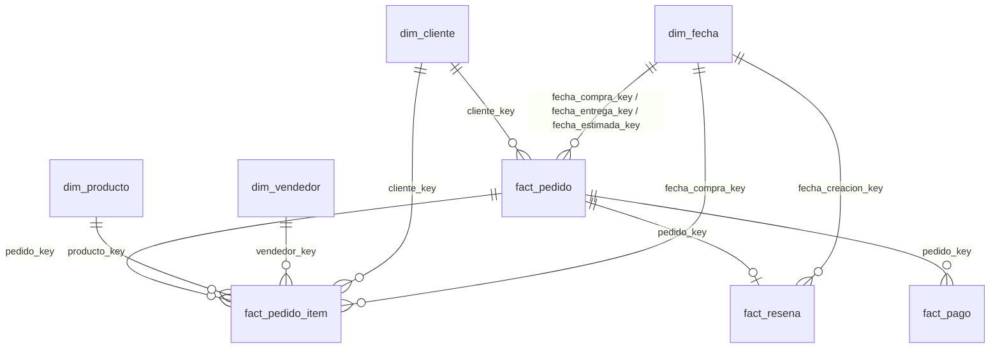

# Diccionario del modelo – OlistDW (esquemas `dw` y `ml`)

Nombres en español, `snake_case`, sin ñ ni tildes. Las tablas `dw.*` se reconstruyen desde `stg` con `02_dimensional/` (ver `README.md`).

> ## Anotaciones importantes (reglas de negocio y decisiones)
> 1. **Regla de la reseña:** de cada pedido se toma **la última reseña, ordenando por `fecha_creacion_resena` y desempatando por `fecha_respuesta_resena`**. Es la regla que usa el ETL y la que reproduce `pedidos_modelado.csv` (95.824 de 95.824 puntajes). La regla inversa (primero respuesta, luego creación) elegiría otra reseña en 14 pedidos y no reproduce el CSV.
> 2. **`cuotas`** (vista de modelado) = las cuotas **del pago de mayor monto** del pedido (no las cuotas máximas). Si hay empate de monto, el ETL toma la primera fila del archivo; en SQL no existe ese orden, así que se desempata por `secuencia_pago DESC`, que iguala el CSV. **Solo el pedido `9f738fc8b806bc3d86ccf78855e82eeb` depende de este desempate.** No se cambió el Python.
> 3. **La traducción de categorías es al inglés, no al español.** `dim_producto.categoria` es el nombre original del dataset (en portugués) y `categoria_ingles` es la traducción oficial. La vista de modelado usa `categoria_ingles` (y si no existe, `categoria`; y si tampoco, `desconocida`), igual que el ETL.
> 4. **Las columnas `pct_*` van de 0 a 100** (por ejemplo `12,81`, no `0,1281`). Las columnas `tasa_*` van de 0 a 1.
> 5. **Los modelos de WSL leen el CSV (`pedidos_modelado.csv`) y no la vista**, porque la autenticación de Windows (`Trusted_Connection`) no funciona desde Linux. La vista `ml.vw_pedidos_entrenamiento` se valida como **equivalente al CSV** (fila por fila, ver `README.md`).
> 6. **Períodos de `dim_fecha` y cómo ordenarlos en Power BI:** ver la sección «Períodos» más abajo. Cada columna de texto se ordena con su columna `*_orden` (Ordenar por columna).
> 7. `anio_mes` se **reemplazó** por `periodo` (mismo contenido `'AAAA-MM'`).

## Diagrama

## Dimensiones

### `dw.dim_cliente` – grano: un cliente (`id_cliente`). 99.441 filas. PK `cliente_key` (identity); clave de negocio `id_cliente` (única).
| Columna | Tipo | Descripción |
|---|---|---|
| `cliente_key` | int identity | Clave sustituta. |
| `id_cliente` | nvarchar(32) | Clave de negocio: identificador del cliente **en cada pedido** (hay uno por pedido). |
| `id_cliente_unico` | nvarchar(32) | Identificador de la persona. Se repite cuando la misma persona compró más de una vez: `COUNT(DISTINCT id_cliente_unico)` = **96.096** clientes únicos. |
| `prefijo_postal` | int | Prefijo postal (sin ceros a la izquierda, como en el origen). |
| `ciudad`, `estado` | nvarchar | Ciudad y estado (sigla de 2 letras). |
| `latitud`, `longitud` | decimal(9,6) | Coordenadas promedio del prefijo postal (de `stg.geolocalizacion`). NULL si el prefijo no está en geolocalización (278 clientes). |
| `es_coordenada_valida` | bit | 1 si la coordenada cae en la caja de Brasil (latitud −34 a 5,5; longitud −74 a −28). No se borra ninguna fila: las coordenadas fuera de la caja (8 clientes) o ausentes quedan con 0. |

### `dw.dim_vendedor` – grano: un vendedor. 3.095 filas. PK `vendedor_key`; clave de negocio `id_vendedor`.
Columnas: `vendedor_key`, `id_vendedor`, `prefijo_postal`, `ciudad`, `estado`, `latitud`, `longitud`, `es_coordenada_valida` (mismas definiciones que `dim_cliente`; 7 vendedores sin coordenada).

### `dw.dim_producto` – grano: un producto. 32.951 filas. PK `producto_key`; clave de negocio `id_producto`.
| Columna | Tipo | Descripción |
|---|---|---|
| `producto_key`, `id_producto` | int identity / nvarchar(32) | Clave sustituta y de negocio. |
| `categoria` | nvarchar(64) | Categoría **original** del dataset (portugués). NULL en 610 productos. |
| `categoria_ingles` | nvarchar(64) | Traducción **al inglés** (`stg.traduccion_categorias`). NULL si no hay traducción (`pc_gamer` y `portateis_cozinha_e_preparadores_de_alimentos`) o si no hay categoría. |
| `longitud_nombre`, `longitud_descripcion`, `cantidad_fotos` | smallint / int | Datos del anuncio. |
| `peso_g`, `largo_cm`, `alto_cm`, `ancho_cm` | int / smallint | Peso y medidas. |

### `dw.dim_fecha` – grano: un día. **800 filas**, del **2016-09-04 al 2018-11-12** (27 meses seguidos). PK `fecha_key` (identity, asignada en orden de fecha); clave de negocio `fecha` (única).
Cubre desde la primera hasta la última de las 5 fechas del pedido (compra, aprobación, entrega al transportista, entrega al cliente y entrega estimada). `fecha_limite_envio` **no** entra: es una columna común en `fact_pedido_item`, sin clave a `dim_fecha`.
| Columna | Tipo | Descripción |
|---|---|---|
| `fecha_key` | int identity | Clave sustituta. |
| `fecha` | date | Clave de negocio. |
| `anio` | smallint | Año. |
| `trimestre`, `mes` | tinyint | 1–4 y 1–12. |
| `nombre_mes` | nvarchar(12) | enero … diciembre (escrito en el script; no depende de la configuración regional). |
| `periodo` | char(7) | `'AAAA-MM'`, por ejemplo `'2018-03'`. |
| `periodo_orden` | int | `AAAAMM`, por ejemplo `201803`. |
| `periodo_trimestre` | char(7) | `'AAAA-T1'` … `'AAAA-T4'`. |
| `periodo_trimestre_orden` | int | `AAAAT`, por ejemplo `20181`. |
| `periodo_semestre` | char(7) | `'AAAA-S1'` o `'AAAA-S2'`. |
| `periodo_semestre_orden` | int | `AAAAS`, por ejemplo `20181`. |
| `dia` | tinyint | Día del mes. |
| `dia_semana` | tinyint | 1 = lunes … 7 = domingo (no depende de `DATEFIRST`). |
| `nombre_dia` | nvarchar(12) | lunes … domingo. |
| `semana_iso` | tinyint | Semana ISO 8601. |
| `es_fin_de_semana` | bit | 1 si sábado o domingo. |

**Períodos – cómo ordenarlos en Power BI:** seleccionar la columna de texto → *Herramientas de columna* → **Ordenar por columna** → elegir la columna `*_orden` correspondiente:
`periodo` → `periodo_orden` · `periodo_trimestre` → `periodo_trimestre_orden` · `periodo_semestre` → `periodo_semestre_orden`. Cada período de texto tiene un único valor de orden (27 meses, 10 trimestres y 5 semestres; sin huecos de meses). `dw.vw_tiempo` y `dw.vw_pedidos` traen `periodo` y `periodo_orden`.

## Hechos

### `dw.fact_pedido` – grano: un pedido. 99.441 filas. PK `pedido_key` (identity, en orden de `id_pedido`); clave de negocio `id_pedido` (única).
Es la **cabecera** del pedido (se agregó a las tres tablas de hechos pedidas porque 775 pedidos no tienen ítems y hace falta una fila por pedido).
Columnas: `pedido_key`, `id_pedido`, `cliente_key` (FK `dim_cliente`), `estado_pedido`, `fecha_compra`, `fecha_aprobacion`, `fecha_entrega_transportista`, `fecha_entrega_cliente`, `fecha_entrega_estimada` (datetime2(0), las tres del medio pueden ser NULL), `fecha_compra_key`, `fecha_entrega_key` (NULL si no hay entrega), `fecha_estimada_key` (FK `dim_fecha`).

### `dw.fact_pedido_item` – grano: un ítem de un pedido. 112.650 filas. PK (`pedido_key`, `numero_item`).
| Columna | Descripción |
|---|---|
| `pedido_key` (FK `fact_pedido`), `numero_item` | Pedido e ítem dentro del pedido. |
| `producto_key`, `vendedor_key`, `cliente_key`, `fecha_compra_key` | FK a `dim_producto`, `dim_vendedor`, `dim_cliente`, `dim_fecha`. |
| `fecha_limite_envio` | datetime2(0). Columna común (hasta 2020-04-09 por datos atípicos del origen); sin clave a `dim_fecha`. |
| `precio`, `flete` | decimal(10,2). |

### `dw.fact_resena` – grano: **una reseña por pedido (la última)**. 98.673 filas. PK/FK `pedido_key`.
Regla: ver la anotación 1. Columnas: `pedido_key`, `id_resena` (se repite entre pedidos en el origen), `puntaje` (1–5), `resena_negativa` (bit, 1 si `puntaje` ≤ 2), `tiene_comentario` (bit), `titulo_comentario`, `mensaje_comentario` (texto con emojis; NULL si no hay), `fecha_creacion_resena`, `fecha_respuesta_resena`, `fecha_creacion_key` (FK `dim_fecha`).

### `dw.fact_pago` – grano: un pago de un pedido. 103.886 filas. PK (`pedido_key`, `secuencia_pago`).
Columnas: `pedido_key`, `secuencia_pago`, `medio_pago`, `cuotas`, `monto_pago` (decimal(12,2)).

## Vistas

### `ml.vw_pedidos_entrenamiento` – 95.824 filas; **equivale a `01_python_etl/data/processed/pedidos_modelado.csv`** (mismas 22 columnas, mismo orden, mismos valores).
Columnas: `id_pedido`, `fecha_compra`, `fecha_entrega`, `id_vendedor`, `puntaje`, `dias_entrega`, `dias_atraso`, `llego_tarde`, `dias_estimados`, `cantidad_items`, `cantidad_vendedores`, `precio_total`, `flete_total`, `flete_sobre_precio`, `peso_total`, `categoria_principal`, `estado_cliente`, `estado_vendedor`, `mismo_estado`, `medio_pago_principal`, `cuotas`, `resena_negativa`.
Definiciones (réplica del ETL; ver también los comentarios del `.sql`):
- **Población:** pedidos `delivered` con `fecha_entrega_cliente`, con reseña y con al menos un ítem.
- **Ítem principal** = el de mayor precio (empate: menor `numero_item`); de ahí `id_vendedor`, `estado_vendedor` y la categoría. `categoria_principal` = traducción al inglés → categoría original → `desconocida`.
- **Pago principal** = el de mayor monto; `medio_pago_principal` y `cuotas` son los de ese pago (anotación 2). Sin pagos: `desconocido` y `cuotas` NULL.
- `dias_*` en días con decimales (segundos / 86400); `llego_tarde` = `dias_atraso` > 0; `peso_total` suma `peso_g` ignorando vacíos; `flete_sobre_precio` solo si `precio_total` > 0; `mismo_estado` = estado del cliente = estado del vendedor principal.

### `dw.vw_pedidos` – una fila por pedido (99.441), para Power BI.
`id_pedido`, `pedido_key`, `cliente_key`, `fecha_compra_key` (claves para el modelo del tablero), `estado_pedido`, `entregado` (1 si `delivered` con fecha de entrega), `fecha_compra`, `periodo`, `periodo_orden`, `fecha_aprobacion`, `fecha_entrega_transportista`, `fecha_entrega`, `fecha_entrega_estimada`, `dias_entrega`, `dias_atraso`, `llego_tarde`, `tramo_atraso`, `tramo_atraso_orden` (estos cinco solo si `entregado` = 1), `cantidad_items`, `precio_total`, `flete_total`, `puntaje`, `resena_negativa` (NULL si no hay reseña), `id_cliente`, `id_cliente_unico`, `estado_cliente`, `ciudad_cliente`, `categoria_principal`, `categoria_es`.
- **`tramo_atraso`** / `tramo_atraso_orden`: `A tiempo` (1), `1 a 3 días` (2), `4 a 7 días` (3), `Más de 7 días` (4). Los atrasos de menos de un día cuentan en «1 a 3 días». Ordenar el texto por `tramo_atraso_orden`.
- **`categoria_principal`** = categoría del **ítem más caro del pedido** (empate: menor `numero_item`), con la misma regla del ETL: traducción al inglés → nombre original → `desconocida`; pedidos sin ítems: `sin items`. **`categoria_es`** = esa misma categoría en español (`dw.map_categoria_es`; `Desconocida` / `Sin ítems`). Hay **una sola categoría por pedido**, la misma que usa el modelo; un pedido con ítems de varias categorías cuenta solo en la de su ítem más caro.
- `id_cliente_unico`: la persona (96.096 distintos); `id_cliente` cambia en cada pedido.

### `dw.map_categoria_es` – traducción de categorías al español, solo para el tablero. 73 filas. PK `categoria`.
| Columna | Descripción |
|---|---|
| `categoria` | Nombre original del dataset (portugués); clave. |
| `categoria_ingles` | Traducción oficial al inglés (la que usa el ETL); NULL en las 2 categorías sin traducción oficial (`pc_gamer`, `portateis_cozinha_e_preparadores_de_alimentos`). |
| `categoria_es` | Nombre en español para mostrar (propio, editable en `02_dimensional/04_crear_map_categoria_es.sql`; único). |

Cubre las 71 categorías de `stg.traduccion_categorias` y las 2 que existen en productos sin traducción. No afecta a `ml.vw_pedidos_entrenamiento` ni a `stg`.

### `dw.vw_vendedores` – una fila por vendedor (3.095).
`id_vendedor`, `ciudad`, `estado`, `latitud`, `longitud`, `es_coordenada_valida`, `pedidos` (distintos con algún ítem del vendedor), `pedidos_entregados`, `pedidos_evaluados` (entregados con reseña: **el denominador; usarlo para filtrar mínimos**), `resenas_negativas`, `facturacion`, `tasa_resena_negativa` (0–1), `tasa_suavizada` (0–1; `(negativas + 20·p0)/(evaluados + 20)` con `p0` = tasa global), `wilson_inferior` y `wilson_superior` (intervalo de Wilson al 95 %, 0–1). Un pedido con ítems de varios vendedores cuenta para cada uno.

### `dw.vw_tiempo` – una fila por mes de compra (25 meses).
`periodo`, `periodo_orden`, `anio`, `mes`, `nombre_mes`, `pedidos` (todos; suman 99.441), `pedidos_entregados`, `pedidos_evaluados`, `resenas_negativas`, `entregas_tardias`, **`pct_resena_negativa`** y **`pct_entregas_tardias`** (0 a 100).

### `dw.vw_geografia` – una fila por estado del cliente (27).
`estado`, `clientes`, `clientes_con_coordenada_valida`, `latitud_promedio`, `longitud_promedio` (solo con coordenadas válidas), `pedidos`, `pedidos_entregados`, `pedidos_evaluados`, `resenas_negativas`, `entregas_tardias`, **`pct_resena_negativa`**, **`pct_entregas_tardias`** (0 a 100).

## Tablas físicas para Power BI (`dw.tbl_*`)
Copias de las vistas `dw.vw_pedidos`, `dw.vw_vendedores` y `dw.vw_geografia` que **lee Power BI** (las vistas quedan como definición y no se usan en el tablero). Mismas columnas, mismo orden y **mismos tipos** que la vista; claves sin NULL. Se llenan con `04_tablas_fisicas/02_refrescar_tablas.sql` (TRUNCATE + INSERT … SELECT FROM la vista) y se crean con `01_crear_tablas.sql`.
| Tabla | Origen | Clave (PK clustered) | Filas |
|---|---|---|---|
| `dw.tbl_pedidos` | `dw.vw_pedidos` | `id_pedido` | 99.441 |
| `dw.tbl_vendedores` | `dw.vw_vendedores` | `id_vendedor` | 3.095 |
| `dw.tbl_geografia` | `dw.vw_geografia` | `estado` | 27 |

Las columnas que la vista nunca deja en NULL (`entregado`, `cantidad_items`, `categoria_principal`, `categoria_es`, los contadores de vendedores y estados) se declaran `NOT NULL`; el resto conserva la nulabilidad de la vista. En el modelo de Power BI las tablas se siguen llamando `vw_*`.

## Esquema `ml` – salidas del modelo
Cargadas por `cargar_ml.py` desde `04_python_ml/outputs/`. **Los CSV no se modifican**; las columnas se renombran solo al cargar.

### `ml.tbl_predicciones` – 19.165 filas (una por pedido del test y modelo). PK (`id_pedido`, `modelo`).
| Columna de la tabla | Columna del CSV | Descripción |
|---|---|---|
| `id_pedido` | `id_pedido` | |
| `modelo` | `modelo` | Modelo recomendado (Random Forest). |
| `probabilidad` | `probabilidad_negativa` | float entre 0 y 1 (restricción CHECK). |
| `riesgo_top20` | `riesgo_top20` | 1 si está en el 20 % de mayor riesgo. |
| `resena_negativa` | `resena_negativa` | Lo que pasó realmente (0/1). |
| `fecha_compra` | `fecha_compra` | |
| `fecha_corrida` | – | Fecha de modificación de `predicciones.csv` (momento en que el modelo generó el archivo). |

### `ml.tbl_resultados_test` – 7 filas.
Mapeo CSV → tabla: `escenario`→`escenario`, `modelo`→`modelo`, `PR-AUC`→`pr_auc`, `AUC-ROC`→`auc_roc`, `F1 (top 20 %)`→`f1_top20`, `recall (top 20 %)`→`recall_top20`, `captura al 20 %`→`captura_20`, `mejora vs baseline`→`mejora_vs_baseline`, `cumple la meta`→`cumple_la_meta`, `IC 95 % PR-AUC`→`ic95_pr_auc`, `IC 95 % diferencia vs baseline`→`ic95_diferencia_vs_baseline`, `remuestreos con PR-AUC ≥ 0,28`→`remuestreos_pr_auc_ge_028`, `recomendado (VC de ajuste)`→`recomendado_vc_ajuste`. Los intervalos y los porcentajes de remuestreo se guardan como texto, tal cual el CSV (p. ej. `[0,285 ; 0,332]`, `99 %`).

### `ml.tbl_pr_auc_mensual` – 4 filas (PK `mes`).
Mapeo: `mes`, `pedidos`, `negativas`, `prevalencia` (iguales); `PR-AUC Random Forest`→`pr_auc_random_forest`; `PR-AUC Gradient Boosting`→`pr_auc_gradient_boosting`; `PR-AUC Regresión logística`→`pr_auc_regresion_logistica`; `PR-AUC baseline`→`pr_auc_baseline`; `nota`→`nota`.

### `ml.tbl_comparacion_cv` – 5 filas (PK `algoritmo`).
Mapeo: `algoritmo`; `PR-AUC medio (VC comparación, 5 tramos)`→`pr_auc_medio_vc_comparacion`; `desvío entre tramos`→`desvio_entre_tramos`; `segundos`. Es la VC de **comparación** (5 tramos), distinta de la VC de **ajuste** del notebook (3 tramos).

### `ml.tbl_importancia_variables` – 16 filas (PK `variable`).
Mapeo: `variable`; `importancia`. Importancia por permutación del Random Forest recomendado (sección 5.3 de `02_modelos`): caída de la PR-AUC en el test al mezclar la variable, promedio de 5 repeticiones (puede ser levemente negativa). El CSV lo escribe `04_python_ml/src/exportar_importancia.py` leyendo el caché del notebook, **sin recalcular**; el desvío entre repeticiones no se guardó en el caché, por eso no hay columna de desvío.
